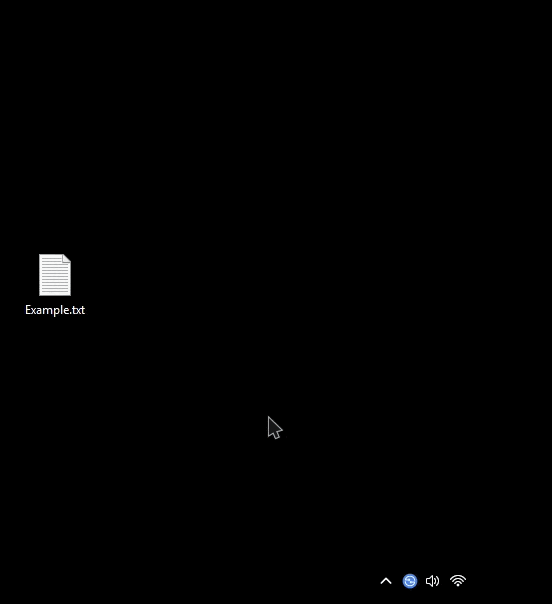

# Quick Share Flyout

Opens Google's Quick Share app as a flyout above the system tray, like the
Windows 11 quick settings, instead of a window in the middle of the screen.

**Requires [Quick Share for Windows](https://www.android.com/better-together/quick-share-app/).**
The mod changes the app's own window, so it does nothing unless the app is
installed.

Click the Quick Share tray icon to open or close the flyout. If the icon is in
the tray overflow menu, the flyout opens beside the menu.

## Features

* Opens above the tray icon, sliding out from the taskbar and fading in
* No title bar, with rounded corners, or a title bar with only a close button
* Stays above other windows, and closes when you click somewhere else
* Drag files onto it from File Explorer
* Moves notifications out of the way while it's open
* Hidden from the taskbar and Alt+Tab
* Adjustable size

## Sending files

Drag files from File Explorer onto the flyout. It stays open while you drag
and after you drop, until you click somewhere else. Clicking another window
closes it, so pick the files first, then open the flyout and drag them in.

You can also right-click files and choose **Send with Quick Share**, or use
**Select** in the flyout.
